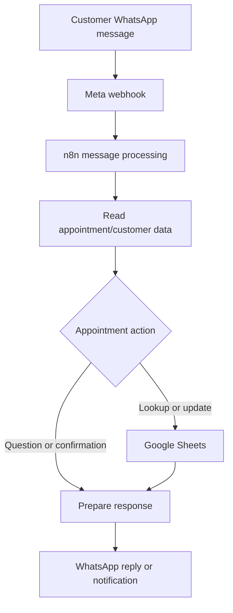

# WhatsApp Appointment Automation

An n8n workflow for handling appointment-related WhatsApp conversations, reading and updating customer/appointment records in Google Sheets, and sending WhatsApp responses or notifications.

> Portfolio project: an automation workflow export intended to be configured and tested in the operator's own environment.

## At a glance

| Area | Implementation |
|---|---|
| Orchestration | n8n |
| Messaging | WhatsApp Business Cloud |
| Data store | Google Sheets |
| Workflow export | `whatsapp-business-bot-for-customer-service-automation.json` — 15 nodes |

## Architecture

This is a high-level representation of the documented workflow purpose. Confirm the exact sheet columns, branches, and message behavior against the exported workflow before deployment.

## Repository contents

- `whatsapp-business-bot-for-customer-service-automation.json` — 15-node n8n workflow export.

## Requirements

- n8n with WhatsApp Business Cloud and Google Sheets nodes.
- A Google Sheet containing the columns referenced by the workflow.
- A Meta app, WhatsApp test/business number, and configured webhook.

## Setup

1. Import the workflow JSON into n8n.
2. Create your own Google Sheets and WhatsApp credentials.
3. Assign credentials to the relevant nodes.
4. Replace sheet/document references and phone-number/recipient placeholders.
5. Configure the Meta webhook and review trigger/schedule settings.
6. Test using a dedicated sheet and non-production WhatsApp number before activation.

Do not commit credentials, live phone IDs, private sheet IDs, or customer message data.

## Validation status

This repository provides a workflow export. This README does not claim that a live Meta-to-Google-Sheets end-to-end test has passed. Validate appointment lookup, updates, recipient routing, non-text inputs, and error handling in your own n8n environment.

## Limitations and next steps

- Google Sheets schema and sample data must be configured by the operator.
- Provider credentials and deployed webhook URLs are not included.
- Add redacted screenshots and a short execution demo after runtime testing.

## License

No license is specified. Contact the repository owner before reusing this project.
